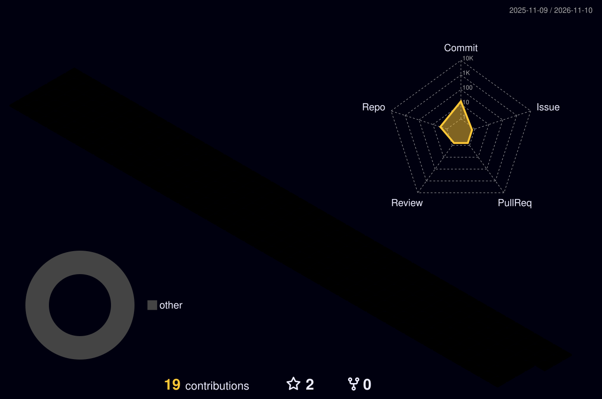

<!-- Header banner -->

  

  

  
  
  
  
  

---

### 👋 About me

- 🤖 I build **AI agents and automations** that take repetitive work off people's plates
- 🏢 SEO Specialist / Web Developer at Equity Track Inc. Philippines, supporting a Bay Area real-estate company (since June 2026)
- 🎓 BS Information Technology graduate, Camarines Sur Polytechnic Colleges (2026)
- 🎨 Also an IT specialist, graphic designer and video editor
- 📄 I document everything: every tool I ship comes with an SOP so a team can run it without me

<table>
  <tr>
    <td>🔭 <b>Building now</b></td><td>Agent routines that run company operations on a schedule</td>
  </tr>
  <tr>
    <td>🌱 <b>Learning</b></td><td>Multi-agent orchestration, GitHub Actions, cloud deployment</td>
  </tr>
  <tr>
    <td>🤝 <b>Open to</b></td><td>AI automation, systems and IT roles (remote or Bicol region)</td>
  </tr>
  <tr>
    <td>⚡ <b>Fun fact</b></td><td>My first shipped app scans museum artifacts on an ESP32-powered turntable</td>
  </tr>
</table>

---

📊 Proven results

<table>
  <tr>
    <td align="center"><h2>100+</h2>AI tools backed up daily</td>
    <td align="center"><h2>2×</h2>daily automated reminders</td>
    <td align="center"><h2>90/100</h2>QA bar before anything publishes</td>
    <td align="center"><h2>15+</h2>operating SOPs written</td>
  </tr>
</table>

---

### 🚀 Featured projects

<table>
  <tr>
    <td width="50%" valign="top">
      <h4>🧠 Agentic SEO Content System</h4>
      7-stage, quality-gated pipeline run by Claude agents: research → outline → draft → 100-point QA → published HTML → assets → monthly Semrush report.  
      <b>Result:</b> every article passes a 90/100 QA bar before publishing.  
      
      
      
    </td>
    <td width="50%" valign="top">
      <h4>📲 Construction Video Reminder Automation</h4>
      Deputy scheduling → twice-daily WhatsApp reminders → Google Chat reports, with duplicate-send protection and outage monitoring. Built with Codex.  
      <b>Result:</b> live since Oct 2026; moved servers with zero data loss.  
      
      
      
    </td>
  </tr>
  <tr>
    <td width="50%" valign="top">
      <h4>🗄️ AI Artifact Backup & Live Directory</h4>
      Scheduled Claude Code routines back up every company AI artifact to GitHub daily; GitHub Actions keep the Monday.com tools board current.  
      <b>Result:</b> 100+ AI tools and their data backed up daily.  
      
      
    </td>
    <td width="50%" valign="top">
      <h4>🎬 Captions Studio</h4>
      Python + Gradio tool that aligns a voice-over script to audio with Whisper and exports branded SRT/ASS captions, with optional FFmpeg burn-in.  
      <b>Result:</b> captioning is now upload → click → download.  
      
      
      
    </td>
  </tr>
  <tr>
    <td colspan="2" valign="top">
      <h4>📱 AR Mobile App for Cultural Preservation — Project Head</h4>
      React Native/Expo app released on Google Play, PHP/MySQL CMS, and an ESP32-controlled rotating platform for 3D artifact scanning.
      &nbsp;<a href="https://github.com/Ophimacus/Rinconada-Artifact-Management">View CMS repo →</a>  
      
      
      
    </td>
  </tr>
</table>

<i>Company projects are private; ask me for a walkthrough.</i>

---

### 🛠️ Tech stack

  

<b>🤖 AI & agents</b>
 

Claude Code (scheduled routines) · Claude Cowork · Claude in Chrome · Claude artifacts & connectors · OpenAI Codex · ChatGPT (incl. image generation) · Gemini · Grok · DeepSeek · Perplexity · Microsoft Copilot · OpenAI Whisper · stable-ts · HeyGen · Higgsfield · Retell AI

<b>💻 Languages, frameworks & dev tools</b>
 

**Languages:** JavaScript (Node.js 24, React Native) · Python · PHP · Java · C# · SQL · Google Apps Script · PowerShell · HTML/CSS · Markdown 
**Frameworks & libraries:** React Native / Expo · CodeIgniter 4 · Gradio · NumPy · matplotlib · docx (Node.js) · pandoc 
**Dev tools:** VS Code · WSL + Ubuntu · Command Prompt · Chrome DevTools · Git / GitHub · GitHub Actions

<b>☁️ Web, cloud & data</b>
 

WordPress · Elementor · ACF PRO · DDEV · WP-CLI · WP Engine · Vercel · Netlify · Supabase · Google Cloud Console & APIs · MySQL · PostgreSQL · SQLite · OAuth 2.0 · Windows DPAPI

<b>🔌 Platforms & integrations</b>
 

Deputy API · WhatsApp · Google Chat apps & webhooks · Gmail · Google Calendar · Google Drive · Google Sheets · Apps Script triggers · Windows Task Scheduler · Google Colab (GPU) · Monday.com · ESP32 · MacroDroid · Automa

<b>📈 SEO & marketing</b>
 

Semrush · Google Search Console · Google Analytics · Google Tag Manager · Bing Webmaster Tools · Bing Places · Yoast · Google Ads · Google Business Profile · YouTube · Reddit · Meta Business Suite · Facebook · Nextdoor · Instantly · CallRail · Google Voice

<b>🏢 Business, real estate & operations</b>
 

REI BlackBook · Intuit QuickBooks · Deputy · PayrollHero · Hubstaff · Specialty Answering Service · PropertyRadar · Redfin · Zillow · MLSListings · TruePeopleSearch · Docusign · SignNow · Adobe Acrobat · iLovePDF · Fireflies.ai · Transkriptor · Google Meet

<b>🖥️ IT administration</b>
 

Google Workspace Admin · Claude Team admin · AnyDesk · AnyViewer · Chrome Remote Desktop · MeshCentral · Windows 11 · hardware repair · network administration

<b>🎨 Design & video</b>
 

Figma · Adobe Photoshop · Canva · Affinity · CapCut · FFmpeg · SRT/ASS captions · UI/UX · branding

---

### 🧩 How I work: frameworks & methods

<b>Agentic AI</b>
 

Agentic workflows (tool use, multi-step tasks) · multi-agent pipelines · scheduled agent routines · human-in-the-loop approval gates · go-signal automations · agent memory files (CLAUDE.md / AGENTS.md) · audit logging & kill switches · dry-run testing · multi-AI cross-verification · prompt engineering

<b>Automation & reliability</b>
 

Event scheduling & rotation logic · idempotent sends (claim ledger) · independent multi-channel reporting · outage monitoring & alerting · encrypted migration with checksums · automated testing · automated backup & change logging · CI workflows · rule-based classification · AI cost reduction

<b>Content & SEO</b>
 

SEO / AEO / GEO strategy · Yoast checklist · quality-gate content pipeline · weighted scoring rubrics · topic cluster & cannibalization analysis · content repurposing (1 article → 6 assets) · brand visual system

<b>Operations, HR & analysis</b>
 

SOP writing · tool directory management · decision boards · PI-style profiling · DISC · Big Five · assessment design · compliance tracking · PH labor compliance (DOLE, NTE) · data verification · asset inventory · security review

---

### 📈 GitHub activity

  
  

  

  

  

<!-- 3D contribution calendar (generated daily by .github/workflows/profile-3d.yml) -->

  

<!-- Contribution snake (generated daily by .github/workflows/snake.yml) -->

  <picture>
    <source media="(prefers-color-scheme: dark)" srcset="https://raw.githubusercontent.com/Ophimacus/Ophimacus/output/github-snake-dark.svg" />
    <source media="(prefers-color-scheme: light)" srcset="https://raw.githubusercontent.com/Ophimacus/Ophimacus/output/github-snake.svg" />
    
  </picture>

<!-- Footer -->

  

